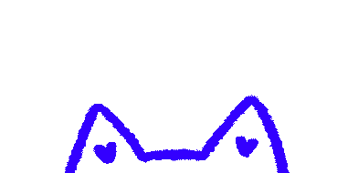

<h1>Hi there, curious human! </h1>

I'm a Multidisciplinary Product Designer with 9+ years of experience. I work across the full cycle of a product, from early research to delivered design. Most of my work has been in regulated industries, mostly pharma. And that's some of tools & technologies which I use:

<table>
  <tr><td width="180">Design &amp; prototyping</td><td>   </td></tr>
  <tr><td width="180">Web</td><td>   </td></tr>
  <tr><td width="180">Editing</td><td> </td></tr>
  <tr><td width="180">AI &amp; assistants</td><td>     </td></tr>
  <tr><td width="180">Documentation &amp; collaboration</td><td>   </td></tr>
</table>

## Socials

   
